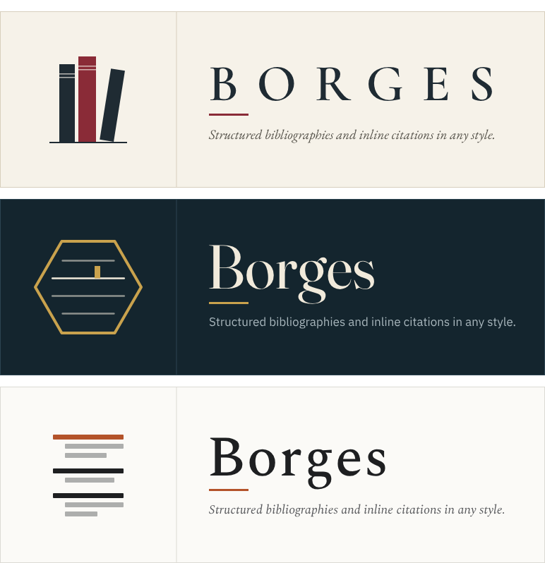

# WordPress.org banner mockups

The banner ideas drawn on 2026-11-23 for a minimalist Borges rebrand. **Folio
(A) was adopted the same day**: the live assets in `.wordpress-org/` are built
from it by `scripts/build_brand_assets.py` (`npm run assets:brand`), and the art
they replaced is in `docs/design/archive/original-art/`. B and C stay here as
the alternatives Dan considered. A version of Folio with the old banner's
handwritten signature was also tried and dropped.

Every variant uses the tagline Dan chose, on a single line: "Structured
bibliographies and inline citations in any style." In A the spaced BORGES is
letterspaced to exactly the tagline's width, so the two lines read as one
justified block.



## What they share

The layout borrows the restraint of Dan's Keel banner: a hairline frame, a
vertical divider, the icon centred in the left panel, then the wordmark, a short
accent rule, and a short tagline. Nothing else. The fonts and colours are
deliberately different from Keel's (Barlow, grey and steel blue), so the two
plugins read as siblings, not twins.

## The variants

| Variant | Wordmark / tagline fonts | Colours | Icon | First-draft tagline |
|---|---|---|---|---|
| A · Folio | Cormorant Garamond SemiBold caps, EB Garamond Italic | ink `#1F2B33`, oxblood `#8A2B37`, paper `#F6F2E9` | three book spines on a shelf | Structured bibliographies for the block editor. |
| B · Hexagon | Fraunces (144 pt optical size), IBM Plex Sans | night `#14252E`, bone `#F1EADB`, brass `#C9A24D` | a hexagonal gallery from "The Library of Babel" with one book pulled | Every citation in its place. |
| C · Index | Spectral Medium, Spectral Italic (the first draft used IBM Plex Mono, which would shrink to about 12px on one line) | ink `#1E1F21`, terracotta `#B4532A`, paper `#FBFAF7` | a small bibliography with hanging indents | Paste a DOI. Get a bibliography. |

- **A** (adopted) is the smallest step from today's branding, since the spines
  echo the current icon, and its book-face type suits a bibliography plugin.
- **B** is the only dark banner, so it stands out most in the directory, and it
  leans hardest into the Borges reference.
- **C** shows what the plugin does in its icon, even at icon size (128px).

## Files

- `borges-banner-{a-folio,b-hexagon,c-index}.svg`: sources,
  with all text as outlines, so they render the same without the fonts.
- `borges-banner-*-772x250.png` and `borges-banner-*-1544x500.png`: the two
  sizes WordPress.org uses, rendered in Chromium.
- `build.py`: regenerates these mockup SVGs. It needs `pip install fonttools uharfbuzz`
  and downloads the fonts (all SIL Open Font License, from Google Fonts) into a
  git-ignored `fonts/` folder on first run.

To render PNGs from the SVGs, any SVG rasterizer works because the text is
already outlined, for example:

```bash
rsvg-convert -w 1544 -h 500 borges-banner-c-index.svg -o borges-banner-c-index-1544x500.png
rsvg-convert -w 772 -h 250 borges-banner-c-index.svg -o borges-banner-c-index-772x250.png
```

## Adoption

Folio was adopted in [#298](https://github.com/dknauss/Borges/pull/298). The
production script draws the same banner and adds the square icon (SVG, 128, 256,
and 512px) and a favicon set, so it, not this folder, is the source for the live
assets.
