# Free-text citation parsing: Borges, AnyStyle, and language models

Borges imports most citations from identifiers (DOI, PMID, PMCID, arXiv, ISBN,
and catalogue IDs) and from structured formats (BibTeX, BibLaTeX, RIS,
CSL-JSON). Those paths fetch or read a record; nothing is guessed. A citation
pasted as plain text with no identifier is the exception: the editor has to
work out which words are the title, the authors, the journal, and so on. This
document records how well Borges's parser does that, compared with
[AnyStyle](https://anystyle.io) and with language models, and why Borges
doesn't use AnyStyle.

The figures come from `tools/markup-value` (`npm run sweep`, October 28,
2026). The full tables are in
[`tools/markup-value/results/2026-10-28.md`](../tools/markup-value/results/2026-10-28.md).

## What AnyStyle is

AnyStyle is an open-source (BSD-2-Clause) citation parser by Sylvester Keil,
who also wrote citeproc-ruby. It takes references as plain text and splits
each one into labelled fields (author, title, container, volume, pages, DOI,
publisher), returning BibTeX or CSL-JSON. It can also find the reference list
in a PDF. It is a statistical model, a conditional random field trained on
hand-labelled references, not a set of rules: it learned what titles,
journals, and page ranges look like and where they usually sit. It ships as
a Ruby gem with a command-line tool (`anystyle-cli`) and as a web service at
anystyle.io.

`tools/markup-value/parser-baseline.mjs` runs AnyStyle 1.6.0 locally as a
stand-in for the pre-language-model way machines read citations.

## Why Borges doesn't use AnyStyle

- **WordPress can't run it.** Borges runs PHP on the server and JavaScript in
  the editor. AnyStyle is Ruby, and its model depends on a compiled library
  (Wapiti). Most hosts, WordPress.com among them, can't run Ruby, and a plugin
  can't install native code.
- **A hosted parser would send citation text off the site.** Borges's
  resolvers contact fixed, well-known sources (Crossref, NCBI, arXiv, Open
  Library, the Internet Archive) and send only an identifier. Calling a hosted
  AnyStyle would send every pasted citation to a third-party service the site
  owner doesn't control, and add a dependency that could go away.
- **Identifiers beat parsing.** A free-text citation with a DOI or a labelled
  PMID in it is resolved at its source before the parser is tried, so the
  parser only handles what has no identifier. A fetched record is better than
  any parse.

## How Borges's parser compares

`tools/markup-value/borges-parser.mjs` (`npm run borges-parser`) runs
`parseFreeTextCitation()` from `src/lib/free-text-parser.js`, the parser the
editor falls back to, over each entry of the plain test page, and scores it
with the same ground truth and rules as the AnyStyle baseline. It measures
the parser alone: in the editor, entries with a DOI would be looked up
instead (8 of the 12 test works have one).

Details recovered (title, authors, year, container, DOI, ISBN, pages,
publisher), with the number of entries Borges's parser accepted at all:

| Style | 12 works: printed (of 67) | AnyStyle | Borges parser | 36 works: printed (of 130) | AnyStyle | Borges parser |
|---|---|---|---|---|---|---|
| Chicago notes-bibliography | 64 | 58 | 40 (12 of 12) | 126 | 110 | 60 (20 of 36) |
| Chicago author-date | 64 | 58 | 18 (9 of 12) | 126 | 97 | 17 (9 of 36) |
| APA 7 | 65 | 56 | 38 (8 of 12) | 127 | 83 | 49 (14 of 36) |
| MLA 9 | 58 | 53 | 13 (9 of 12) | 128 | 105 | 37 (15 of 36) |
| Harvard | 59 | 51 | 0 (0 of 12) | 113 | 82 | 0 (0 of 36) |
| IEEE | 64 | 59 | 2 (1 of 12) | 120 | 95 | 7 (16 of 36) |
| Vancouver | 58 | 46 | 0 (0 of 12) | 123 | 76 | 0 (0 of 36) |
| OSCOLA | 48 | 23 | 0 (0 of 12) | 121 | 55 | 0 (0 of 36) |
| ABNT | 59 | 53 | 3 (2 of 12) | 124 | 82 | 31 (9 of 36) |

```mermaid
xychart-beta
    title "Details recovered from the plain 12-work list (of 67)"
    x-axis ["Chic. N-B", "Chic. A-D", "APA", "MLA", "Harvard", "IEEE", "Vanc.", "OSCOLA", "ABNT"]
    y-axis "Details" 0 --> 67
    bar [64, 64, 65, 58, 59, 64, 58, 48, 59]
    bar [58, 58, 56, 53, 51, 59, 46, 23, 53]
    bar [40, 18, 38, 13, 0, 2, 0, 0, 3]
```

Bars, left to right in each group: printed by the style, AnyStyle, Borges's
parser.

What this shows:

- **Borges's parser is a Chicago and APA parser.** It recognizes the patterns
  [`supported-input-style-matrix.md`](supported-input-style-matrix.md)
  declares (Chicago and APA-like books, articles, chapters, web pages,
  reviews, theses) and declines the rest. It accepts all twelve Chicago
  notes-bibliography entries in the small test and 20 of 36 in the larger
  one, most of APA's twelve, and almost nothing in Harvard, IEEE, Vancouver,
  OSCOLA, or ABNT.
- **Declining is the intended failure.** An entry the parser doesn't accept
  gets a notice in the editor, not a wrong record, so the zeros are entries
  turned away, not entries mangled.
- **Even where it parses, it trails AnyStyle.** On the twelve Chicago
  notes-bibliography entries it gets every title but only 5 of 12 author
  lists, 7 of 11 years, 4 of 8 DOIs, and 4 of 8 page ranges; AnyStyle gets
  10, 10, 8, and 7.

## Why the style matters for every machine reader

A style decides what is on the page. OSCOLA prints no DOIs or ISBNs, cuts
long author lists, and gives only first pages, so 48 of the 67 test details
are there to read; APA prints 65. No reader of the plain list can do better
than the style allows.

Within that limit, readers differ:

- **Language models** (Claude Haiku, Sonnet, and Opus, once each) read every
  detail the style printed and nothing it didn't: 65 of 67 in APA, 48 of 67
  in OSCOLA, and 124 of 130 for the 36 works in Chicago. Asked ten questions
  about the OSCOLA page, Sonnet answered 5 from the plain list (saying "not
  on the page" for the other 5, without guessing) and 10 from the page with
  Borges's JSON-LD.
- **AnyStyle** depends on the style's punctuation. It does best with IEEE,
  whose quoted titles, `vol.`, `no.`, and `pp.` label the fields, and worst
  with OSCOLA, which has no full stops, puts publisher and year together in
  parentheses, and is probably rare in its training data. That explanation
  is inferred from the styles and the parser, not tested.
- **Borges's parser** handles the styles it was written for.

Borges's JSON-LD carries all 67 details (130 for the 36 works) in every
style, so for machines the choice of style stops mattering once the markup is
there. The style should follow the human readers: numeric styles such as
IEEE suit numbered in-text citations and engineering readers, and Chicago
notes-bibliography suits footnotes.

## What could improve the parser

- **Add the styles Borges formats.** Harvard, IEEE, Vancouver, OSCOLA, and
  ABNT are all output styles but not parser inputs. The test corpora give a
  ground truth for each.
- **Use AnyStyle as a yardstick, not a dependency.** `npm run sweep` now
  reports both parsers side by side; a parser change can be measured against
  AnyStyle on the same entries.
- **Borrow test data, not code.** AnyStyle's labelled training references
  (the `anystyle-data` gem) could become parser fixtures, if their licence
  allows it; check before copying any.
